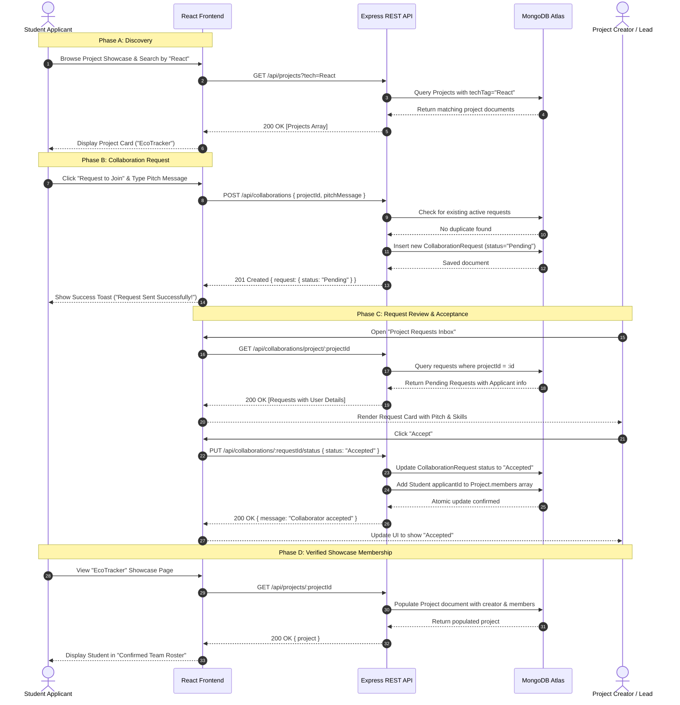
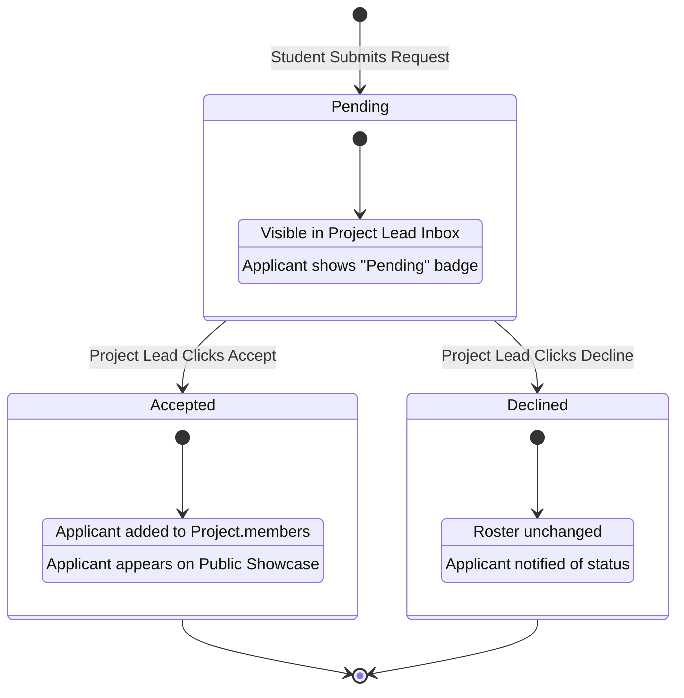

# CollabSphere: User Workflows & System Journeys

> **Document Version:** 1.0.0  
> **Status:** Approved Baseline for MVP  
> **Focus:** End-to-End User Experience & Interaction Design  

---

## 1. Overview of Platform Actors

1. **Visitor (Unauthenticated)**: A prospective student, faculty member, or guest exploring the public discovery portal.
2. **Student Member (Authenticated)**: A verified student who can curate their profile, publish showcases, and apply to collaborate on projects.
3. **Project Lead (Authenticated Project Creator)**: A student who created a project showcase, responsible for managing project details and reviewing join requests.

---

## 2. High-Level Collaboration Flow

The following Mermaid sequence diagram illustrates the complete primary journey from discovering a project to becoming a confirmed team member:

---

## 3. Detailed Workflows

---

### Workflow 1: Student Account Registration & Login
* **Actor**: Visitor / Student.
* **Preconditions**: User is on the CollabSphere landing page and does not have an active session.

#### Step-by-Step Actions:
1. User clicks **"Sign Up"** in the navigation header.
2. System renders the Registration form requesting:
   * Full Name
   * Email Address (e.g., student university/personal email)
   * Password & Confirm Password
   * Academic Department (e.g., Computer Science & Engineering)
   * Graduation Year / Current Semester
3. User completes fields and clicks **"Create Account"**.
4. Client validates format locally (valid email regex, passwords match, password $\ge 6$ chars).
5. Client issues `POST /api/auth/register` with payload.
6. Server checks if email already exists in MongoDB:
   * **If exists**: Returns `400 Bad Request` (`"Email already registered"`).
   * **If new**: Hashes password with `bcryptjs`, saves user document, and signs a JWT.
7. Server responds with `201 Created` returning `{ token, user }`.
8. Client stores token securely in `localStorage` and redirects user to **Profile Setup** or **Dashboard**.

#### Success Outcome:
Student is authenticated, navigation displays student's name/avatar, and protected features are unlocked.

#### Failure Scenarios:
* Missing required fields $\rightarrow$ Form shows inline validation errors.
* Passwords do not match $\rightarrow$ Form prevents submission and highlights password fields.
* Network or server offline $\rightarrow$ Client displays error alert: *"Server unavailable. Please try again."*

---

### Workflow 2: Profile Setup & Skill Tagging
* **Actor**: Authenticated Student Member.
* **Preconditions**: Student is logged in (`FR-AUTH-03`).

#### Step-by-Step Actions:
1. Student navigates to **"My Profile"** $\rightarrow$ **"Edit Profile"**.
2. Form loads existing profile information from `GET /api/users/profile/me`.
3. Student adds or updates:
   * Professional headline / Bio (e.g., *"Full-stack enthusiast interested in scalable web systems"*).
   * Technical skills: User types a skill (e.g., `React`) and presses `Enter` or clicks an `Add` pill to append to the skills array.
   * Social links: GitHub profile URL, LinkedIn profile URL, personal portfolio link.
4. Student clicks **"Save Profile"**.
5. Client issues `PUT /api/users/profile/me` with updated payload.
6. Server validates URLs and sanitized text, updates document in MongoDB, and responds with `200 OK`.
7. Client displays success notification toast and updates local cached profile state.

#### Success Outcome:
The student profile reflects the updated skills and bio, making the student discoverable in directory searches.

#### Failure Scenarios:
* Invalid URL format (e.g., entering `"mygithub"` instead of a valid URL) $\rightarrow$ Server returns `400 Bad Request`; client highlights input field.
* Session expired $\rightarrow$ Server returns `401 Unauthorized`; client prompts student to log in again.

---

### Workflow 3: Student Discovery & Directory Search
* **Actor**: Any User (Visitor or Authenticated Student).
* **Preconditions**: Platform contains registered student profiles.

#### Step-by-Step Actions:
1. User clicks **"Students"** in the main navigation.
2. Client sends `GET /api/users` and renders the student directory grid.
3. User types a query into the search bar (e.g., `"Nirav"`) or clicks a skill filter pill (e.g., `Node.js`).
4. Client dispatches query `GET /api/users?skill=Node.js&search=Nirav`.
5. Server filters students using indexed MongoDB regex and array matching.
6. Server returns matching student summaries (name, department, semester, skills, bio snippet).
7. User clicks a student card to open their public profile (`/students/:id`).

#### Success Outcome:
User explores student profiles and reviews their technical portfolios and active projects.

#### Empty State Scenario:
* No students match the filter $\rightarrow$ System renders an empty-state illustration: *"No students found matching these skills. Try clearing your filters."*

---

### Workflow 4: Project Showcase Publication
* **Actor**: Authenticated Student Member.
* **Preconditions**: Student is logged in.

#### Step-by-Step Actions:
1. Student clicks **"Post Project"** button in navigation.
2. System displays the Project Creation Form:
   * Title
   * Tagline / Brief Summary
   * Problem Statement & Full Description
   * Tech Stack (multi-select / tag input pills: `React`, `Node.js`, `MongoDB`, etc.)
   * GitHub Repository URL
   * Live Demo URL (optional)
   * Open Collaboration Toggle: `"Looking for Collaborators?"` (Checkbox: default `checked`)
   * Required Roles (e.g., `"Frontend UI Developer, API Designer"`)
3. Student clicks **"Publish Showcase"**.
4. Client sends `POST /api/projects` with `Authorization: Bearer <token>`.
5. Server attaches `req.user.id` as `creator`, initializes `members: []`, validates fields, and saves to MongoDB.
6. Server returns `201 Created` with project ID and slug.
7. Client redirects student to the newly created showcase page (`/projects/:id`).

#### Success Outcome:
Project is publicly published and appears in the project discovery feed.

#### Failure Scenarios:
* Missing mandatory fields (e.g., missing title or GitHub URL) $\rightarrow$ Client displays field errors and prevents submission.
* Network failure $\rightarrow$ Error alert displayed; form contents preserved in state so user doesn't lose typed text.

---

### Workflow 5: Project Discovery & Filtering
* **Actor**: Any User.
* **Preconditions**: None.

#### Step-by-Step Actions:
1. User navigates to **"Projects"** showcase page (`/projects`).
2. Page displays a search bar, quick-filter tags (e.g., `MERN`, `Python`, `AI/ML`, `Mobile`), and an **"Open for Collaboration"** checkbox.
3. User selects `Open for Collaboration` and tag `React`.
4. Client requests `GET /api/projects?tech=React&open=true`.
5. Server returns filtered project list.
6. Cards display: Project Title, Tagline, Tech Badges, "Seeking Teammates" badge, and Creator Avatar.
7. User clicks a project card to view full details.

#### Success Outcome:
User finds projects matching their technical interests and collaboration availability.

---

### Workflow 6: Submitting a Collaboration Request
* **Actor**: Authenticated Student (not the project creator).
* **Preconditions**: 
  * Student is logged in.
  * Project has `isAcceptingMembers: true`.
  * Student is not already the project creator or an existing member.

#### Step-by-Step Actions:
1. Student views the project showcase page (`/projects/:id`).
2. Student views the **"Apply to Collaborate"** action card.
3. Student clicks **"Request to Join"**.
4. A modal dialog opens prompting for a **Pitch Message**:
   * *"Explain why you want to join and what you can contribute..."* (textarea, 20–500 chars).
5. Student enters message: *"Hi, I'm experienced in React and TailwindCSS. I'd love to help build the client dashboard!"*
6. Student clicks **"Submit Application"**.
7. Client dispatches `POST /api/collaborations` with `{ projectId, pitchMessage }`.
8. Server verifies:
   * `req.user.id !== project.creator` (Cannot apply to own project).
   * No existing request with `status: "Pending"` for this user and project.
9. Server saves request document with `status: "Pending"`.
10. Server returns `201 Created`.
11. Client updates modal to success checkmark and changes page button to **"Application Pending"** (disabled).

#### Failure Scenarios:
* Unauthenticated user clicks "Request to Join" $\rightarrow$ Client intercepts and redirects to `/login` with return redirect parameter.
* Student already applied $\rightarrow$ Server responds `400 Bad Request` (`"You already have a pending request for this project"`).
* Creator applies to own project $\rightarrow$ Server responds `400 Bad Request` (`"Cannot apply to your own project"`).

---

### Workflow 7: Reviewing & Managing Collaboration Requests
* **Actor**: Project Creator / Lead.
* **Preconditions**: Student is logged in and owns projects with pending requests.

#### Step-by-Step Actions:
1. Project creator navigates to **"Dashboard"** $\rightarrow$ **"Project Management"** $\rightarrow$ **"Collaboration Requests"**.
2. Client requests `GET /api/collaborations/creator`.
3. Server returns list of incoming requests grouped by project, populated with applicant name, department, semester, skills, and pitch message.
4. Lead reviews an applicant card.
5. Lead has two actions:
   * **Click "Accept"**:
     * Client sends `PUT /api/collaborations/:requestId/status` with `{ status: "Accepted" }`.
     * Server updates request status to `Accepted`.
     * Server atomically appends `applicantId` to `Project.members` array.
     * Server returns `200 OK`.
     * Client updates request badge to `Accepted` and shows confirmation toast.
   * **Click "Decline"**:
     * Client sends `PUT /api/collaborations/:requestId/status` with `{ status: "Declined" }`.
     * Server updates request status to `Declined`.
     * Server returns `200 OK`.
     * Client updates card badge to `Declined`.

#### Success Outcome:
Project team composition is updated, and applicant receives transparent status resolution.

---

## 4. Collaboration Request State Machine

The following diagram defines the finite states and valid transitions for collaboration requests:

---

## 5. Error Handling, Edge Cases & Empty States

| Context | Edge Case / Error | Expected UI / System Behavior |
| :--- | :--- | :--- |
| **Network Failure** | Backend server or MongoDB Atlas is offline. | Banner alert appears at top of viewport: *"Unable to reach server. Please check your connection."* Forms disable submit buttons to prevent double-submissions. |
| **Authorization Violation** | Student crafts an API call to edit someone else's project. | Server rejects with `403 Forbidden` (`"Not authorized to modify this resource"`). Client renders *"Access Denied"* screen. |
| **Resource Not Found** | User navigates to `/projects/651234abcd` that does not exist. | Client renders a polite `404 Not Found` page with a button: *"Return to Projects Showcase"*. |
| **Empty Search Results** | Search query yields 0 matching projects or students. | Clean empty state with search illustration, text: *"No results match your query"*, and a `"Clear Filters"` button. |
| **Closed Projects** | Project creator toggles `isAcceptingMembers: false`. | "Request to Join" button on showcase is replaced with a disabled badge: *"Not Currently Accepting Teammates"*. |
